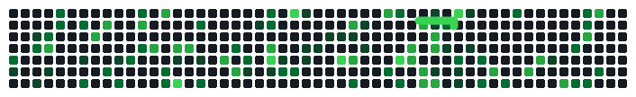
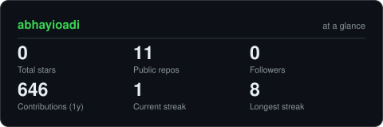
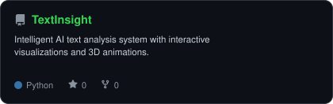
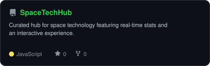
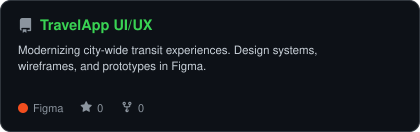
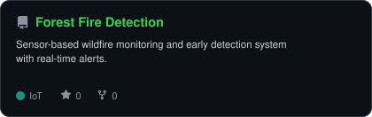

<div align="center">

<!-- PORTRAIT - generated by scripts/dotify.py from assets/bg removed.png.
     Colour mode, so one file serves both GitHub themes. Regenerate with:
       python scripts/dotify.py "assets/bg removed.png" -o assets/portrait \
         --cols 80 --equalize --detail 0.5 --color --reveal -->


<br>

<!-- NAME / TAGLINE - animated typing -->
<a href="https://github.com/abhayioadi">
  
</a>

<br>

<!-- SOCIALS -->
<a href="https://www.linkedin.com/in/abhayadityars"></a>
<a href="mailto:abhayaditya1875@gmail.com"></a>
<a href="https://abhayadityars.vercel.app/"></a>


</div>

---

## `~/` whoami

```console
$ cat about.txt
```

Hi, I'm **Abhay Aditya R S**. I build things that sit somewhere between UI/UX design and engineering,
crafting digital experiences that feel intuitive, accessible, and effortlessly fluid.

- Currently building **[SpaceTechHub](https://github.com/abhayioadi/space-tech-hub)** and **[OrbitGuard](https://github.com/abhayioadi/OrbitGuard)**
- Portfolio: **[abhayadityars.vercel.app](https://abhayadityars.vercel.app/)**
- Learning **React + Machine Learning**
- Fun fact: **I started coding seriously because I wanted to build things I wished existed.**

<br>

<div align="center">

## `~/` toolbox

</div>

### 🎨 Design & UI/UX

[](https://figma.com)
[](https://adobe.com/products/xd)
[](https://adobe.com/products/illustrator)
[](https://adobe.com/products/photoshop)
[](https://canva.com)
[](https://rive.app)
[](https://miro.com)

<br>

### 💻 Frontend Development

[](https://developer.mozilla.org/en-US/docs/Web/HTML)
[](https://developer.mozilla.org/en-US/docs/Web/CSS)
[](https://developer.mozilla.org/en-US/docs/Web/JavaScript)
[](https://react.dev)
[](https://tailwindcss.com)

<br>

### ☕ Programming & Development

[](https://www.java.com)
[](https://python.org)
[](https://www.postgresql.org)

<br>

### ☁️ Cloud & Tools

[](https://cloud.google.com)
[](https://git-scm.com)
[](https://github.com)
[](https://code.visualstudio.com)

<br>

### 🚀 Creative & Productivity

[](https://notion.so)
[](https://framer.com)
[](https://spline.design)
[](https://penpot.app)

---

<div align="center">

## `~/` skill radar

<table>
<tr>
<td width="50%" align="center" valign="middle">

<!-- Self-rated radar - edit assets/skills.json, the workflow redraws it -->
<picture>
  <source media="(prefers-color-scheme: dark)"  srcset="assets/radar-dark.svg">
  <source media="(prefers-color-scheme: light)" srcset="assets/radar-light.svg">
  
</picture>

</td>
<td width="50%" align="center" valign="middle">

<!-- Live radar built from real language byte counts across your repos -->
<picture>
  <source media="(prefers-color-scheme: dark)"  srcset="assets/radar-langs-dark.svg">
  <source media="(prefers-color-scheme: light)" srcset="assets/radar-langs-light.svg">
  
</picture>

</td>
</tr>
</table>

</div>

---

<div align="center">

## `~/` contribution calendar

<!-- 3D isometric calendar, regenerated every 6h by .github/workflows/metrics.yml -->


<!-- Snake eats the contribution graph - .github/workflows/snake.yml -->
<picture>
  <source media="(prefers-color-scheme: dark)"  srcset="assets/snake-dark.svg">
  <source media="(prefers-color-scheme: light)" srcset="assets/snake.svg">
  
</picture>

</div>

---

<div align="center">

## `~/` the numbers

<!-- Generated by scripts/cards.py into this repo. Deliberately NOT
     github-readme-stats / streak-stats / github-profile-trophy: those are
     shared public instances that go down and take the whole section with them. -->
<picture>
  <source media="(prefers-color-scheme: dark)"  srcset="assets/card-stats-dark.svg">
  <source media="(prefers-color-scheme: light)" srcset="assets/card-stats-light.svg">
  
</picture>

<br>


<!--  -->

</div>

---

<div align="center">

## `~/` selected work

<!-- Cards generated by scripts/cards.py from assets/projects.json.
     Stars, forks and language are pulled live from the API on every run. -->
<table>
<tr>
<td width="50%">
  <a href="https://github.com/abhayioadi">
    <picture>
      <source media="(prefers-color-scheme: dark)"  srcset="assets/card-TextInsight-dark.svg">
      <source media="(prefers-color-scheme: light)" srcset="assets/card-TextInsight-light.svg">
      
    </picture>
  </a>
</td>
<td width="50%">
  <a href="https://github.com/abhayioadi/space-tech-hub">
    <picture>
      <source media="(prefers-color-scheme: dark)"  srcset="assets/card-SpaceTechHub-dark.svg">
      <source media="(prefers-color-scheme: light)" srcset="assets/card-SpaceTechHub-light.svg">
      
    </picture>
  </a>
</td>
</tr>
<tr>
<td width="50%">
  <a href="https://abhayadityars.vercel.app/">
    <picture>
      <source media="(prefers-color-scheme: dark)"  srcset="assets/card-TravelApp-UIUX-dark.svg">
      <source media="(prefers-color-scheme: light)" srcset="assets/card-TravelApp-UIUX-light.svg">
      
    </picture>
  </a>
</td>
<td width="50%">
  <a href="https://github.com/abhayioadi/ForestFire_detection">
    <picture>
      <source media="(prefers-color-scheme: dark)"  srcset="assets/card-ForestFire_detection-dark.svg">
      <source media="(prefers-color-scheme: light)" srcset="assets/card-ForestFire_detection-light.svg">
      
    </picture>
  </a>
</td>
</tr>
</table>

<sub>

<!--| project | live | stack |
|---|---|---|
| **[TextInsight](https://github.com/abhayioadi)** | [Live Demo](https://abhayadityars.vercel.app/) | `Python` `ML` `React` |
| **[SpaceTechHub](https://github.com/abhayioadi/space-tech-hub)** | [spacetechhub.vercel.app](https://spacetechhub.vercel.app/) | `HTML` `CSS` `JavaScript` |
| **[UI/UX Travel App](https://abhayadityars.vercel.app/)** | [abhayadityars.vercel.app](https://abhayadityars.vercel.app/) | `Figma` `Wireframing` `UI/UX` |
| **[Forest Fire Detection](https://github.com/abhayioadi/ForestFire_detection)** | [forestfiredetection.vercel.app](https://forestfiredetection.vercel.app/) | `IoT` `Sensors` `Arduino` |-->

</sub>

</div>

---

<div align="center">

<sub>`01110100 01101000 01100001 01101110 01101011 01110011 00100000 01100110 01101111 01110010 00100000 01110011 01100011 01110010 01101111 01101100 01101100 01101001 01101110`</sub>

</div>
